# agent-ready-codebase-recipe

Make your agent's work verifiable in your repo.

Stop your agent from shipping mistakes by setting up your project with complete, reliable, and deterministic verification. One agent skill, `setup-agent-ready-codebase`, does the setup.

You let your agent do the work, but what you deliver is about the same as before, because:

- **The tests your agent writes aren't reliable.** Thousands of unit tests pass, yet none of them use the tools you run in your real environment.
- **Many checks still need you.** Your agent can't sign in, use a real account or reach a live database on its own, so you end up checking its work yourself.
- **Agents can't run the project at the same time.** Two agents running at once fight over ports, files and one local database.
- **You still review what a tool could check.** Formatting slips and lint errors reach your review, when a linter and formatter could have rejected them first.
- **Your agent can't use your app.** It can't open the app and go through it as a user would, so it never sees what its change does.
- **Your logs are hard to read and query.** When something breaks, your agent scrolls through plain text instead of looking up the request that failed.

An agent rarely builds these parts mid-task, so the skill builds them once and writes down how to use them.

The skill is opinionated about principles, not tools. You choose the tool for each job and it recommends a well-known, mature, open-source option that is free for commercial use. A job your project already does with a tool keeps that tool unless you choose to move.

It also sizes the setup to the project. Before checking anything, it learns what the project is, who uses it and what a broken release costs, then proposes how deep each area goes for you to confirm. A UI that runs fully on the client, such as a component library, a native app with no backend or a static site of any size, gets component tests instead of end-to-end flows. A UI that talks to a server gets end-to-end tests, since only a run through client and server together proves that seam. A small internal tool gets structured request logs without a log store or analytics.

## Install

```sh
npx skills add itsfaqih/agent-ready-codebase-recipe
```

Then run `/setup-agent-ready-codebase` in the project to set up. On a project that is already set up, it adds only what is missing.

## What it sets up

Each project gets only the jobs below that its profile calls for, each done by a tool you chose. A static landing page, for example, gets lint, component tests, and pull request screenshots, and none of the backend, e2e, or mutation machinery.

- Parallel worktrees that do not collide on ports, installs, containers or files
- Lint checks that read every file type in the repo, one script per tool, with rules that catch unsafe types and weak tests
- Stricter compiler settings and lint rules that reject code the checker cannot verify, each one only if you accept it
- Unit and integration tests that start their own dependencies, so a fresh clone with only Docker passes
- Mutation and property-based tests that find the tests still missing, where the logic is costly to get wrong
- Substitutes for outside services, so tests and agents never touch a real account
- Seeded users and no blockers, so an agent reaches every screen as every role
- End-to-end tests that save a screenshot per step, and a video when a live interaction needs one, or component tests when the UI runs fully on the client
- An app driver the agent can use directly, whether the app runs in a browser, on a device, on a desktop or in a terminal
- Wide events you can query per request, and product analytics that stays off outside production
- Pull requests with annotated screenshots as evidence

## How a run works


1. **Audit.** The skill writes a profile of the project, proposes a depth for each stage (`full`, `light` or `n/a`) for you to confirm, then checks each stage against the project and marks it `done`, `partial` or `missing`, citing the command output or file that shows it.
2. **Fill the gaps.** It leaves `done` stages alone, adds what is missing to `partial` stages, and builds `missing` stages from scratch. It merges an existing doc instead of overwriting it, and the report lists every conflict.
3. **Audit again.** The run ends when every applicable stage is `done` and the second audit changes no file.

## What the agent reads afterwards

The instructions file holds one pointer per installed doc, each saying when to read it, so a doc enters the agent's context only when its task comes up. A project gets only the docs its profile calls for. A static site, for example, has no `testing.md`, `hermetic-dependencies.md`, `agent-access.md`, `e2e.md` or `observability.md`. Each doc lives once, in [`templates/docs/`](skills/setup-agent-ready-codebase/templates/docs/), and the skill copies it into the project's `docs/`.

| Doc in `docs/` | Read it when |
| --- | --- |
| `stack.md` | you pick or swap a tool, or start or restructure a backend, frontend or infrastructure |
| `worktrees.md` | you add a port, path, compose service, migration or env var |
| `lint.md` | you add a file type or hit a lint finding |
| `boundaries.md` | you handle input from outside the program or branch on a union |
| `testing.md` | you write or change a unit or integration test, or look for missing tests |
| `hermetic-dependencies.md` | a test needs a database, queue, cloud service or third-party API |
| `falsifiable-tests.md` | you write or review any test, or fix a bug |
| `agent-access.md` | you add auth, a provider, a verification step or a seeded user |
| `e2e.md` | you add or change a user flow or screen |
| `component-tests.md` | you add or change a component or one of its states |
| `e2e-mobile.md` | you add or change a flow in a native iOS or Android app |
| `app-use.md` | you interact with the running app directly |
| `observability.md` | you add a route, log line or analytics event |
| `screenshots.md` | you capture an image for a pull request or report |
| `pull-requests.md` | you open or update a pull request |
| `lessons.md` | you make the same mistake twice |
