# agent-ready-codebase-recipe

One agent skill, `setup-agent-ready-codebase`, that sets up a codebase so any agent in any worktree can change code, reach every screen, and prove the change works.

Agents can already read a codebase and write tests. Many codebases still lack the setup that makes running those tests reliable:

- Parallel agents collide on ports and files
- Tests need a live database or a real account
- Screens need a sign-in the agent cannot complete
- Tests pass whatever the code does

An agent rarely builds these parts mid-task, so the skill builds them once and writes down how to use them.

The skill is opinionated about principles, not tools. You choose the tool for each job and it recommends a well-known, mature, open-source option that is free for commercial use. A job your project already does with a tool keeps that tool unless you choose to move.

It also sizes the setup to the project. Before checking anything, it learns what the project is, who uses it and what a broken release costs, then proposes how deep each area goes for you to confirm. A component library gets component tests in a real browser instead of end-to-end flows, and a small internal tool gets structured request logs without a log store or analytics.

## Install

```sh
npx skills add itsfaqih/agent-ready-codebase-recipe
```

Then run `/setup-agent-ready-codebase` in the project to set up. On a project that is already set up, it adds only what is missing.

## What it sets up

Each project gets the jobs below that fit it, each done by a tool you chose:

- Parallel worktrees that do not collide on ports, installs, containers or files
- Lint checks for every file type in the repo, with rules that catch unsafe types and weak tests
- Stricter compiler settings and lint rules that reject code the checker cannot verify, each one only if you accept it
- Unit and integration tests that start their own dependencies, so a fresh clone with only Docker passes
- Substitutes for outside services, so tests and agents never touch a real account
- Seeded users and no blockers, so an agent reaches every screen as every role
- End-to-end tests that save a screenshot per step, and a video when a live interaction needs one, or component tests for a component library
- A browser driver the agent can use directly
- Wide events you can query per request, and product analytics that stays off outside production
- Pull requests with annotated screenshots as evidence

## How a run works


1. **Audit.** The skill writes a profile of the project, proposes a depth for each stage (`full`, `light` or `n/a`) for you to confirm, then checks each stage against the project and marks it `done`, `partial` or `missing`, citing the command output or file that shows it.
2. **Fill the gaps.** It leaves `done` stages alone, adds what is missing to `partial` stages, and builds `missing` stages from scratch. It merges an existing doc instead of overwriting it, and the report lists every conflict.
3. **Audit again.** The run ends when every applicable stage is `done` and the second audit changes no file.

## What the agent reads afterwards

The instructions file holds one pointer per installed doc, each saying when to read it, so a doc enters the agent's context only when its task comes up. Each doc lives once, in [`templates/docs/`](skills/setup-agent-ready-codebase/templates/docs/), and the skill copies it into the project's `docs/`.

| Doc in `docs/` | Read it when |
| --- | --- |
| `stack.md` | you pick or swap a tool, or start or restructure a backend, frontend or infrastructure |
| `worktrees.md` | you add a port, path, compose service, migration or env var |
| `lint.md` | you add a file type or hit a lint finding |
| `boundaries.md` | you handle input from outside the program or branch on a union |
| `testing.md` | you write or change a unit or integration test |
| `hermetic-dependencies.md` | a test needs a database, queue, cloud service or third-party API |
| `falsifiable-tests.md` | you write, fix or review any test |
| `agent-access.md` | you add auth, a provider, a verification step or a seeded user |
| `e2e.md` | you add or change a user flow or screen |
| `component-tests.md` | you add or change a component or one of its states |
| `e2e-mobile.md` | you add or change a flow in a native iOS or Android app |
| `browser.md` | you interact with the running web app directly |
| `observability.md` | you add a route, log line or analytics event |
| `screenshots.md` | you capture an image for a pull request or report |
| `pull-requests.md` | you open or update a pull request |
| `lessons.md` | you make the same mistake twice |
